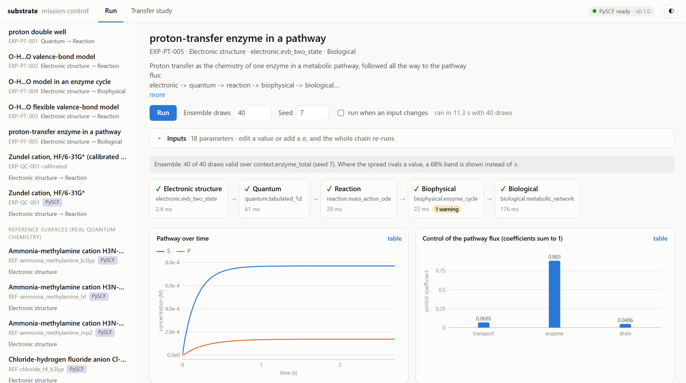
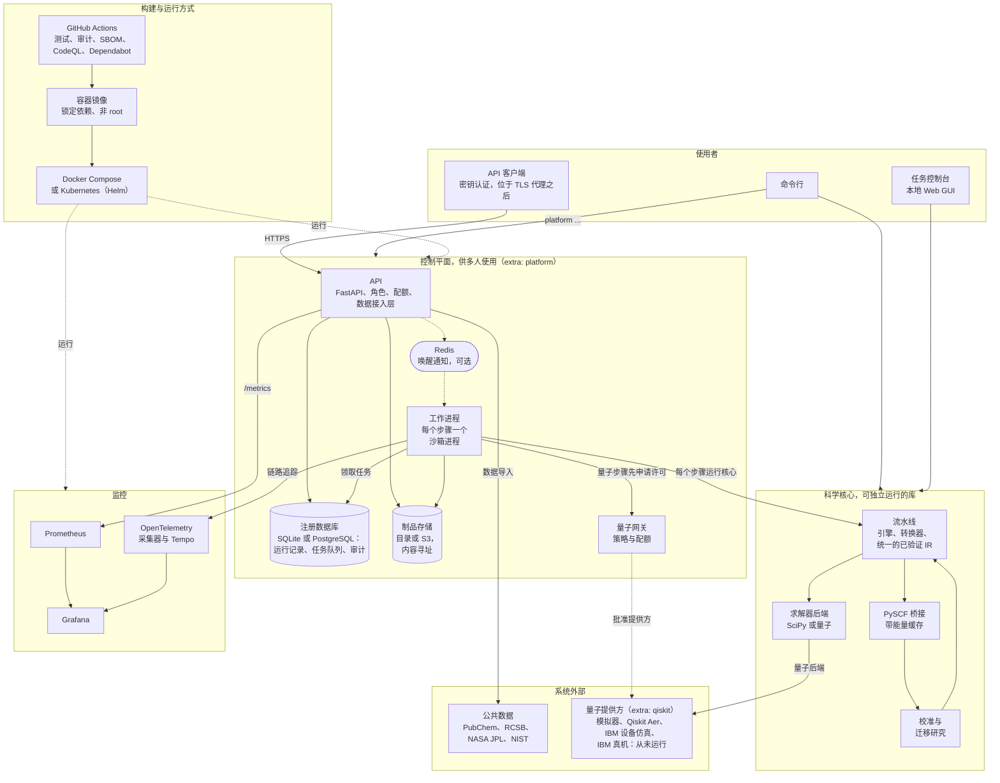
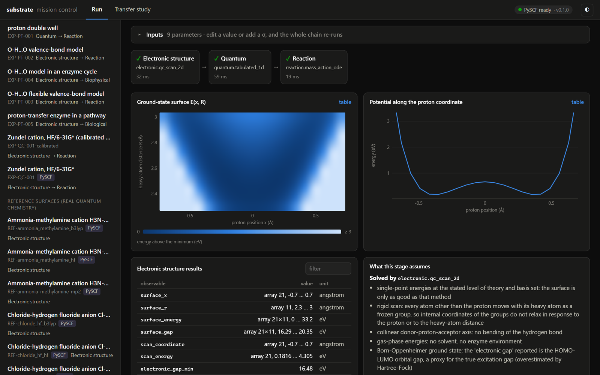
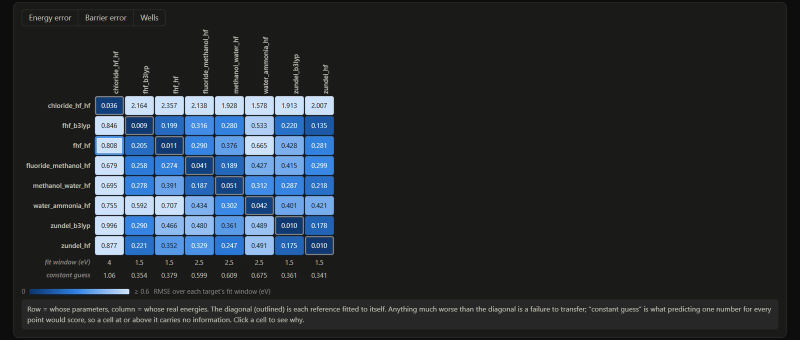
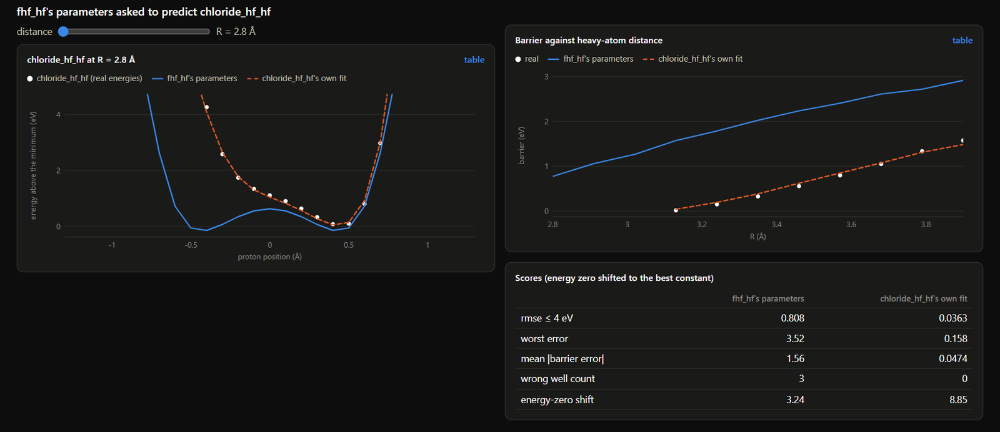
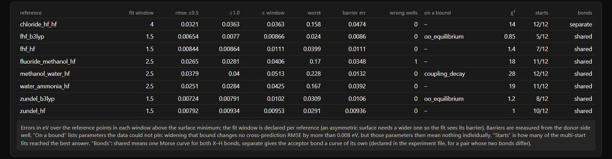
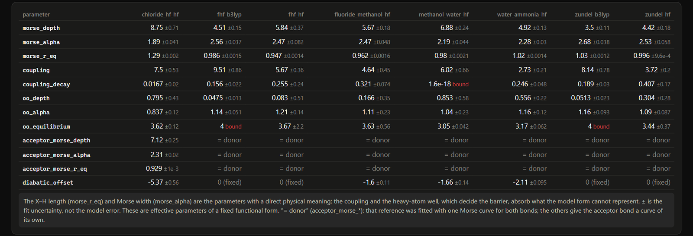
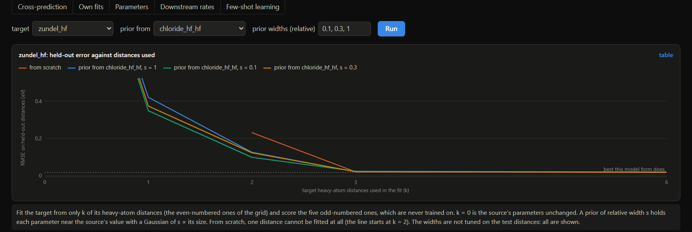
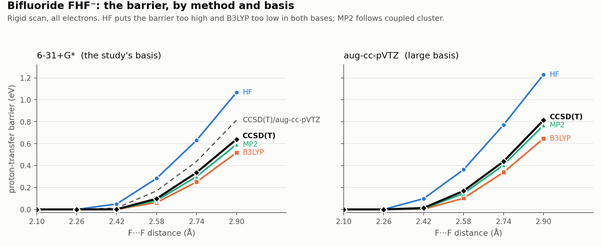

<div align="center">

# substrate

**通过统一的表示，让科学模型跨尺度传递——每一次跨越都有文档记录、经过验证。**

[English](README.md) | 简体中文


<picture>
  <source media="(prefers-color-scheme: dark)" srcset="docs/images/hero-dark.png">
  
</picture>

</div>

`substrate` 沿着一个物理过程被建模的各个尺度对它进行追踪：从电子哈密顿量，经过原子核量子动力学和反应动力学，一直到酶以及代谢通路的通量。任何内容想要跨越尺度边界，都必须经过一个**转换器（Translator）**：它附有一份书面的近似条件清单，以及一个用实际数值检验这些近似是否成立的 `validate()`。如果物理上不支持这次跨越，流水线会停下来并给出原因，而不是凭空编造结果。

在此之上是一项基于**真实量子化学**（PySCF，从 Hartree–Fock 到 CCSD(T)）的定量研究：一个廉价的价键模型，用某个分子在某一理论水平下拟合得到的参数，能否用来描述另一个分子？答案基本是否定的，而本仓库测量了其中的原因。

核心之外是一个把它作为服务运行的**控制平面**：带租户、角色和配额的 API，任务队列和沙箱化的工作进程，内容寻址的制品存储，可复现性检查，实时数据源，量子求解器提供方，监控，以及 Docker、Kubernetes 和 Helm 部署。[下方的总览](#系统全景)展示了这一切如何连接。

> **状态：研究原型。** 软件经过了细致的测试，它对自身的各项描述都有实测依据。其中的化学部分是一个基于刚性、气相扫描的*试验平台*，并不是对任何真实体系动力学的预测。引用任何数字之前，请先阅读[局限说明](docs/limits.md)。

## 系统全景

`substrate` 由两个可以独立使用的部分组成：一个**科学核心**（Python 库和命令行工具，沿着各尺度追踪同一个过程），以及围绕它的**控制平面**（把同一个核心作为服务提供给多人使用）。图中其他所有内容都是为这两者之一服务的。



阅读说明：实线箭头表示调用或数据流；虚线表示可选或间接关系（Redis 只是通知空闲的工作进程尽快检查，网关只负责授权，“运行”表示部署位置）。

- **单独使用时**，核心只依赖 NumPy、SciPy 和 PyYAML。命令行和 GUI 直接调用流水线；真实的量子化学数据通过能量缓存从 PySCF 获取，校准与迁移研究构建在其之上。
- **作为服务时**，API 接收运行请求，数据库保存任务队列；工作进程（每个步骤一个沙箱进程）领取任务，运行同一条流水线，并把产出以内容寻址制品的形式保存。每次运行结束时给出一个六维状态，`reproduce` 会重新运行并进行比对。
- **量子求解器**在实验文件的 `backend:` 块中指定。网关会先检查提供方策略和用户配额。模拟器、Qiskit Aer 以及 Qiskit 对 IBM 设备的仿真都已实际运行过；IBM 真机没有运行过，因为没有可用的凭据。
- **外部数据**（PubChem、RCSB、NASA JPL 谱线目录、内置的 NIST 数据集）只能通过数据接入层的白名单 HTTPS 客户端进入平台，并以带版本号和校验和的数据集形式存储。
- **监控与部署**是代码之外的配置，而非代码的一部分：Prometheus 抓取 API 指标，任务链路经 OpenTelemetry 采集器发送到 Tempo，Grafana 同时展示两者。一个锁定依赖、非 root 的容器镜像可运行于 Docker Compose（单机）或 Kubernetes（清单或 Helm Chart），GitHub Actions 负责测试、审计和构建。

哪些内容真实运行过、哪些没有，见 [docs/platform.md](docs/platform.md)；哪些威胁有防护、哪些没有，见 [SECURITY.md](SECURITY.md)。

## 亮点

- **统一的表示。** `ScientificSystem` 携带带单位的数值（只检查、不自动换算）、不确定度以及溯源哈希链；每个产出都会记录其输入、所用后端、生成它的组件所做的近似，以及相关警告。
- **宁可拒绝，也不猜测。** 两条长度相同的路径代表不同的物理，因此规划器会抛出 `AmbiguousPathError`，要求你明确指定路线；如果势垒低于零点能，流程会在该阶段停下并说明原因，同时保留所有已完成的结果。
- **真实量子化学，带缓存。** 对任何具有“供体–质子–受体”轴的分子，使用 PySCF 计算单点能（HF、DFT、MP2、CCSD、CCSD(T)），按内容存储到磁盘，因此之后的每次运行以及不确定性集合中的每次抽样都能瞬间完成。
- **诚实诊断的校准。** 把价键模型拟合到真实势能面上，查看哪些参数落在边界上、每个参数的确定程度如何，以及拟合结果对从未见过的距离的预测效果。报告中明确说明：拟合的不确定度*不等于*模型的误差。
- **迁移研究。** 21 个真实势能面（7 个分子 × 3 种方法；另外还构建了 3 个），包括交叉预测、经由真实链路得到的下游速率和同位素效应、少样本学习曲线、耦合簇基准测试，以及“把化学键固定为自由双原子分子数值后结论是否依然成立”的检验。
- **与实测数据对比。** 加载 NIST 的质子亲和能和酸度数据（附不确定度和出处），并与五个非对称离子计算得到的势阱能量差进行比较——分离后的碎片均经过弛豫，并计入 298 K 下的焓。其中三个离子吻合到约 0.1 eV；一个（氟离子–甲醇）在研究使用的基组下偏差 0.2–0.3 eV，换用 aug-cc-pVTZ 后吻合。
- **把输入视为不可信。** 实验文件作为数据读取，使用安全加载器（禁止别名、限制嵌套深度和大小、禁止 `NaN`）；每项计数都有由运行环境（而非文件本身）设定的上限，并在分配任何资源前检查；缓存经过签封；CI 审计锁定的依赖并发布 SBOM。威胁模型以及*未*防护的内容见 [SECURITY.md](SECURITY.md)。
- **任务控制台。** 基于同一套引擎的本地 Web GUI：修改任意输入，整条链路都会重新运行；也可以把迁移研究作为可点击的矩阵来探索。
- **面向多人的控制平面。** API、按租户隔离且带角色与配额的注册表、任务队列与工作进程（每个步骤独立进程）、内容寻址制品、用六维运行状态取代简单的“失败”、可重新运行并比对的 `reproduce`、白名单数据接入层（PubChem、RCSB、NASA JPL 谱线目录、内置 NIST 数据集）、位于策略网关之后的量子求解器（模拟器以及 Qiskit 的 IBM 设备仿真；从未在真实量子设备上运行）、可选的 Redis 唤醒、指标、链路追踪和 Grafana 仪表盘，以及 Docker Compose、Kubernetes 清单和 Helm Chart。哪些真实运行过、哪些没有，见 [docs/platform.md](docs/platform.md)。
- **严格测试。** 1,956 个测试，包含闭式解和独立计算的校验，并对数值代码和控制平面进行了变异测试（当时运行的 612 个变异体中捕获了 586 个，其余 26 个均有说明；此后新增的 Redis、JPL 和 Qiskit 代码尚未进行变异测试）。在我自己工作中发现的 bug 都会列出，不会隐瞒。

## 截图

以下截图均来自真实 GUI（`python -m substrate gui`），使用的是本仓库中缓存的能量数据。

**从真实势能面到反应速率。** 由 PySCF 计算的 Zundel 阳离子 H₅O₂⁺（一个质子被两个类水单元共享）的 Hartree–Fock/6-31G* 能量面，以及沿质子坐标的双势阱——它是原子核量子动力学的输入。下方面板列出了该阶段所做的假设。



**拟合参数能否迁移？** 把每一组校准参数原封不动地应用到其他每一个势能面上：行表示参数来源，列表示真实能量来源；对角线是每个势能面拟合自身的结果。明显差于对角线的就是迁移失败；“常数猜测”一行表示只预测一个常数时的得分。



点击任意单元格可查看原因。这里用二氟化物的参数去预测氯离子–氟化氢离子：真实能量（点）、二氟化物参数的预测（蓝色）、该离子自身的拟合（虚线）、各距离下的势垒以及得分。



<details>
<summary>更多视图：自身拟合、拟合参数、少样本学习</summary>

**自身拟合。** 每组校准对自身势能面的复现程度、指出拟合不佳之处的诊断信息，以及所拟合的化学键模型。



**参数。** 拟合值及其不确定度。不同分子的键长和宽度看起来相近；而决定势垒的耦合项和重原子势阱则差别很大。`= donor` 表示该势能面对两根化学键使用同一条 Morse 曲线拟合。



**少样本学习。** 仅用目标体系的 k 个重原子距离进行拟合（分别在使用和不使用另一势能面参数作为高斯先验的情况下），并在留出的距离上评分。



</details>

## 快速开始

```bash
git clone https://github.com/hastikacheddy/substrate.git
cd substrate
pip install -e ".[dev,platform]"                                     # platform 扩展用于控制平面；科学核心只需 ".[dev]"

python -m substrate run experiments/proton_transfer_pathway.yaml     # 五个尺度，九个阶段
python -m substrate gui                                              # 任务控制台，http://127.0.0.1:8765/
pytest -m "not qc"                                                   # 1,883 个测试，无需 PySCF（约 12 分钟）
```

实验是一个 YAML 文件。当路线唯一时，只需指定目标尺度即可；给某个输入加上 `sigma`，它就会变成贯穿整条链路的蒙特卡洛抽样：

```yaml
experiment:
  phenomenon: pathway_flux_from_proton_transfer
  system:
    scale: electronic_structure
    kind: electronic.evb_two_state
    parameters:
      coupling: {value: 0.6, unit: eV}
      context.k_release:    {value: 1.0e4, unit: 1/s}                  # 原样传递到每一个尺度
      context.enzyme_total: {value: 1.0e-6, unit: M, sigma: 2.0e-7}    # 有 sigma => 生成集合
  propagation: [biological]
```

### 作为服务运行

控制平面是在同一安装基础上的可选扩展：

| 扩展 | 增加的内容 |
|---|---|
| `dev` | 用于运行测试的 pytest 和 httpx |
| `platform` | 控制平面：API、注册表、队列、工作进程、制品、数据接入层、指标 |
| `postgres` | PostgreSQL 驱动（SQLite 无需额外驱动） |
| `otlp` | 将链路追踪导出到 OpenTelemetry 采集器 |
| `redis` | 工作进程的 Redis 唤醒（没有它时工作进程轮询数据库） |
| `s3` | 兼容 S3 的制品存储 |
| `qiskit` | Qiskit 量子提供方（Aer、IBM 设备仿真、IBM 真机） |
| `plots` | 基准测试图表 |

```bash
# 单机：PostgreSQL、Redis、API、两个工作进程、采集器、Tempo、Prometheus 和 Grafana，全部监听本地回环地址。
# 请先创建密钥文件（见 deploy/secrets/README.md），然后：
docker compose -f deploy/docker-compose.yml up -d --build
docker compose -f deploy/docker-compose.yml run --rm api platform init --tenant lab    # 仅打印一次首位管理员的密钥
python deploy/verify_networks.py        # 在 Docker 25.0 + Compose 2.24 上检查是否有容器悄无声息地丢失了网络

# 集群部署（请先创建命名空间和密钥：见 deploy/k8s/README.md）
kubectl apply -k deploy/k8s             # 或：helm install substrate deploy/helm/substrate -n substrate
```

API、状态维度、复现、数据接入层、量子提供方，以及哪些内容在真实系统上运行过，均见 [docs/platform.md](docs/platform.md)。

### 真实量子化学

计算真实能量需要 [PySCF](https://pyscf.org)，它没有 Windows 版本。在 Linux 或 macOS 上，`pip install pyscf` 即可。在 Windows 上，`scripts/setup_qc_env.sh` 会在 WSL 中创建一个隔离环境（无需 `sudo`，不做任何系统级修改，全部内容位于 `~/.substrate-qc`；用 `rm -rf ~/.substrate-qc` 即可删除）：

```bash
wsl bash /mnt/c/<本项目路径>/scripts/setup_qc_env.sh
```

引擎会自动查找 PySCF（能导入时在进程内调用，否则通过 WSL 调用）；可用 `SUBSTRATE_QC_MODE`、`SUBSTRATE_QC_WSL_DISTRO` 和 `SUBSTRATE_QC_WSL_PYTHON` 覆盖自动查找。能量按内容缓存在 `~/.cache/substrate`（或 `SUBSTRATE_CACHE_DIR`）中：一次扫描首次运行需要几分钟，之后每次都是瞬间完成。大基组下一个耦合簇单点约需一分半钟，因此这类任务会被拆成小块分批发送给工作进程。

每个缓存的能量都带有摘要签封，损坏或被手动修改的条目会被重新计算，而不是直接返回。`python -m substrate cache status` 按状态、程序版本和工作进程统计条目数；`cache verify [--delete]` 和 `cache purge --corrupt | --unverified | --worker DIGEST` 用于清理；设置 `SUBSTRATE_QC_CACHE_STRICT=1` 后只返回当前工作进程写入的条目。

### 示例

| 命令 | 展示内容 |
|---|---|
| `python examples/zundel_real_chemistry.py` | 一个真实的 Hartree–Fock 势能面，一直算到速率和同位素效应 |
| `python examples/calibrate_against_real_chemistry.py` | 用廉价模型拟合该势能面，并比较其速率与真实链路的差距 |
| `python examples/transfer_across_molecules_and_methods.py` | 21 个参考体系的研究：全部对比（首次运行约计算 4,500 个能量） |
| `python examples/anchoring_the_bonds.py` | 把每根化学键固定为自由双原子分子的数值，重新拟合全部 24 个势能面 |
| `python examples/benchmark_bifluoride.py` | 在同一网格上用两种基组比较 HF、B3LYP、MP2 和 CCSD(T)（`--figure` 绘图） |
| `python examples/validate_against_nist.py` | 非对称离子的计算势阱能量差与实测质子亲和能差（NIST）对比：刚性、弛豫以及计入 298 K 焓 |
| `python examples/basis_check_fluoride_methanol.py` | 为什么有一个离子与实测能量差不符：三种基组下的 B3LYP、aug-cc-pVTZ 下的 MP2 与 CCSD(T)，以及热力学项 |
| `python examples/pathway_isotope_effect.py` | 同位素效应何时能从分子层面一直保留到通路通量 |
| `python examples/enzyme_isotope_effects.py`、`molecular_vs_quantum.py`、`donor_acceptor_sweep.py` | 承诺（commitment）区间；求速率的两条路线；势垒随重原子距离的变化 |
| `python -m substrate calibrate experiments/zundel_hf.yaml --out calibrated.yaml` | 把模型拟合到真实势能面，并输出一个毫秒级即可运行的实验文件 |
| `python -m substrate transfer experiments/references/*.yaml` | 在命令行中对任意一组参考势能面进行交叉预测 |

## 架构

包含控制平面、数据源、量子提供方、监控和部署在内的完整系统见上文的[系统全景](#系统全景)。科学核心的高层与底层架构图（尺度与转换器、一次运行的逐步过程、核心类型、量子化学桥接、双态模型、校准与迁移、任务控制台）请参阅[英文 README 的 Architecture 一节](README.md#architecture)，文字说明见 [docs/architecture.md](docs/architecture.md) 和 [docs/science.md](docs/science.md)。

## 研究发现

详细内容（包括所有数字以及失败的预测）见 [docs/findings.md](docs/findings.md)。

- **同位素效应只有在三个条件同时满足时，才能从分子层面保留到通路通量。** 化学步骤本身的 H/D 效应约为 10；当化学步骤是酶内的限速步、酶处于饱和状态、且该酶控制整个通路时，通量层面的效应为 10.0；只要其中任何一个条件被打破，就会降到 1.00、1.11 或 1.00。
- **对于单个分子，校准后的模型可以代替真实化学计算。** 拟合到 Zundel 阳离子的 Hartree–Fock/6-31G* 势能面后，模型在原子核采样区域内的复现误差为 0.01 eV，其速率在九个数量级范围内都保持在真实链路的 0.72–1.21 倍之间，而每条链路只需约 35 毫秒，而不是几分钟的能量计算。
- **拟合参数无法迁移。** 每个势能面的自身拟合误差为 0.01–0.06 eV；把同一组参数用到同一分子另一种方法的势能面上，误差变为 0.16–0.25 eV；用到另一个分子上，中位误差为 0.34–0.39 eV，是自身拟合误差的十倍，并且在 420 对中有 89 对比直接预测一个常数还差。
- **这并不是放开化学键参数所导致的假象。** 拟合得到的键长和宽度*确实*具有物理意义（与自由双原子分子相差仅几个百分点）。把它们固定在自由分子的数值上会让拟合明显变差（中位误差 0.031 → 0.119 eV），迁移效果也没有改善：真正依赖于分子和方法的，是决定势垒的耦合项、重原子势阱和能量偏移。
- **两根化学键不同的体系需要为每根键单独设一条曲线。** 氯离子–氟化氢离子无法用一条 Morse 曲线拟合（0.41 eV）；使用 `bonds: separate` 后，在 HF、B3LYP 和 MP2 下的拟合误差为 0.03–0.04 eV，平衡键长接近自由 HCl 和 HF 的数值。
- **势能面大体上把化学描述对了，而有一个离子揭示了它们的不足。** 与 NIST 实测的质子亲和能和酸度相比（所有碎片均弛豫并计入 298 K 焓），在三种方法下，五个非对称离子中有三个的计算长程势阱能量差与实测值相差约 0.1 eV 以内（五个离子的平均误差：B3LYP 为 +0.01 eV，MP2 为 +0.02 eV，HF 为 +0.15 eV）。氟离子–甲醇在研究所用的 6-31+G* 基组下偏大 0.22–0.33 eV；换用 aug-cc-pVTZ 后与实验值在不确定度范围内一致。这也修正了此前的一个解读：拟合得到的能量偏移与势能面*计算出的*能量差同序，而不是与实测值同序。
- **各方法之间本身就存在分歧，且方向是已知的。** 对二氟化物离子的 CCSD(T) 基准测试显示，HF 的势垒偏高、B3LYP 的偏低；在 2.74 Å 处，研究所用势能面相对 CCSD(T)/aug-cc-pVTZ 势垒的偏差分别为 +0.19（HF）、−0.19（B3LYP）和 −0.14 eV（MP2），在 300 K 下相当于速率相差约一千倍。

<picture>
  <source media="(prefers-color-scheme: dark)" srcset="docs/images/benchmark-barrier-dark.png">
  
</picture>

## 科学现状

请阅读 [docs/limits.md](docs/limits.md)，简要来说：

- 廉价模型的参数是**等效参数，而非物理参数**：拟合得到的耦合项为 3–20 eV，拟合的能量偏移在 Hartree–Fock 下是势能面自身长程势阱能量差的 1.1–1.9 倍，在 B3LYP 和 MP2 下为 1.8–4.6 倍。拟合效果好只说明模型足够灵活，并不说明模型是对的。
- 扫描是**刚性、共线、气相**的，且使用的基组较小。与某个离子的 CCSD(T)/aug-cc-pVTZ 结果相比，研究中的势垒在 2.74 Å 处偏差 0.14–0.19 eV，对于计算绝对速率来说误差过大。
- 研究包含的是**七个分子，而不是二十一个独立样本**（同一分子的不同方法之间存在相关性），按“化学距离”排序的结论仅依赖于两对母体–衍生物。
- EVB 参数具有体系特异性，这一点在文献中早已为人所知；本项目的贡献在于对其进行了细致的测量，并保留了失败的预测。
- 化学之上的尺度（酶、通路）使用的是自由设定的输入，展示的是底层化学*如何*被体现或被掩盖，而不是真实体系的行为。

## 验证

共 1,956 个测试：其中 1,883 个无需 PySCF 即可运行（安装全部扩展时约 12 分钟，其中 21 个在 Windows 上或缺少真实的 Redis、S3 服务、PostgreSQL 或网络时会被跳过；只安装科学核心时运行 1,280 个、跳过 36 个，约 6 分钟），另外 73 个需要真实的量子化学程序。测试使用闭式解和独立计算，而不是让代码与自身比对：

- 双态模型与引擎的对角化结果一致到 1e-10；闭式校准能精确恢复无噪声的势能面，并对含噪声的势能面给出诚实的不确定度。
- PySCF 桥接通过物理规律进行检验：变分原理与 Hartree–Fock 极限、刚体运动下的不变性、CCSD 对双电子体系是精确的（因此三重激发修正为零），以及将自由双原子分子的零点能与数值求解薛定谔方程的结果对比。
- 测试本身是会失败的：对校准、迁移、分离化学键、双原子分子、引擎和命令行代码运行了一百多个单行变异体；每个存活的变异体要么暴露了真实的测试缺口（现已补上），要么被记录为等价变异体。
- 本项目自身代码中发现的 bug 都列在 [docs/validation.md](docs/validation.md) 中，其中包括一个被两个浏览器标签页同时访问时暴露出来的 ODE 求解器线程安全问题。

## 仓库结构

```
src/substrate/
  ir.py  base.py  pipeline.py  workflow.py      科学 IR、引擎/转换器约定、路由、溯源与集合
  engines/                                      电子（模型与真实量子化学）、分子、量子、反应、生物物理、生物
  translators/                                  尺度之间有文档、经过验证的转换
  qc/                                           PySCF 桥接：任务、SQLite 能量缓存、在 WSL 中运行的独立工作进程
  calibration.py  transfer.py  diatomics.py     将模型拟合到势能面；交叉预测与学习曲线；自由 X–H Morse 曲线
  datasets.py  data/  fragments.py              带溯源信息的实测参考值（NIST 质子亲和能与酸度）；将复合物拆分为四个碎片
  limits.py  safeload.py                        资源限制（来自运行环境）以及不信任实验文件的加载器
  qpu.py  qpu_qiskit.py                         小型态矢量模拟器、量子求解器后端以及约束量子任务的策略；Qiskit 提供方（`qiskit` 扩展）
  control/                                      控制平面：API、注册表、角色与配额、队列、工作进程、沙箱、制品、数据接入层、Redis 唤醒、指标（`platform` 扩展）
  molecules.py                                  分子模板：Zundel、铵二聚体、二氟化物、水–氨、甲醇–水……
  gui/                                          本地 Web GUI：标准库服务器、原生 HTML/JS，无需构建、不发出外部请求
deploy/                                         Dockerfile、Docker Compose、Kubernetes 清单、Helm Chart、Prometheus、Grafana、Tempo 与 OpenTelemetry 配置、verify_networks.py；
                                                huggingface/ 用于构建并上传以演示形式运行 GUI 的 Hugging Face Space（Docker 版，或在浏览器中运行的静态版）
experiments/                                    可运行的实验文件；references/（24 个真实势能面）与 benchmarks/（8 个二氟化物势能面）
examples/                                       上文表格中的示例脚本
tests/                                          1,956 个测试
docs/                                           架构、科学原理、研究发现、验证、局限、扩展指南、图片
.github/                                        CI（Python 3.10 至 3.13 的测试、Qiskit 提供方、依赖审计、SBOM、容器构建）、CodeQL、Dependabot；requirements-*lock.txt 文件锁定依赖版本
SECURITY.md                                     威胁模型、已防护与未防护的内容、漏洞报告方式
```

## 文档

| | |
|---|---|
| [docs/findings.md](docs/findings.md) | 各项研究的测量结果，附数字和失败的预测 |
| [docs/limits.md](docs/limits.md) | 这些数字能支撑什么、不能支撑什么 |
| [docs/science.md](docs/science.md) | 按尺度逐一介绍已实现的科学内容 |
| [docs/architecture.md](docs/architecture.md) | IR、路由、后端、量子化学桥接、GUI |
| [docs/platform.md](docs/platform.md) | 控制平面：运行、状态维度、复现、数据接入层、部署，以及尚未验证的内容 |
| [docs/validation.md](docs/validation.md) | 各部分如何测试，以及测试发现的 bug |
| [docs/extending.md](docs/extending.md) | 如何添加新的尺度或模型 |
| [SECURITY.md](SECURITY.md) | 威胁模型、已防护与未防护的内容、漏洞报告方式 |
| [deploy/k8s/README.md](deploy/k8s/README.md)、[deploy/secrets/README.md](deploy/secrets/README.md) | 在 Kubernetes 上安装；创建密钥文件 |

## 开发

```bash
pip install -e ".[dev,platform]"   # 需要基准测试图表时加 ".[plots]"；需要对应部署选项时加 ".[postgres,otlp,redis,s3]"；需要 Qiskit 量子提供方时加 ".[qiskit]"
pytest                             # 运行全部测试；标记为 `qc` 的测试需要 PySCF，缺失时自动跳过
pytest -m "not qc"                 # 运行不需要 PySCF 的 1,883 个测试
```

## 致谢与许可

量子化学计算使用 [PySCF](https://pyscf.org)；双原子分子光谱常数和质子亲和能来自 [NIST Chemistry WebBook](https://webbook.nist.gov/chemistry/)。数值计算使用 NumPy 和 SciPy。控制平面基于 FastAPI、SQLAlchemy、PostgreSQL、Redis、Prometheus、Grafana、Grafana Tempo 和 OpenTelemetry 构建，量子提供方基于 Qiskit。数据来自 [PubChem](https://pubchem.ncbi.nlm.nih.gov)、[RCSB 蛋白质数据库](https://www.rcsb.org) 以及 NASA JPL 的亚毫米波、毫米波和微波谱线目录（H. M. Pickett, R. L. Poynter, E. A. Cohen, M. L. Delitsky, J. C. Pearson and H. S. P. Muller, J. Quant. Spectrosc. Radiat. Transfer 60, 883-890, 1998；[spec.jpl.nasa.gov](https://spec.jpl.nasa.gov)）。

本项目尚未选择开源许可证，因此适用默认版权规定（保留所有权利）。如果你希望使用本项目或参与贡献，请提交 issue。
