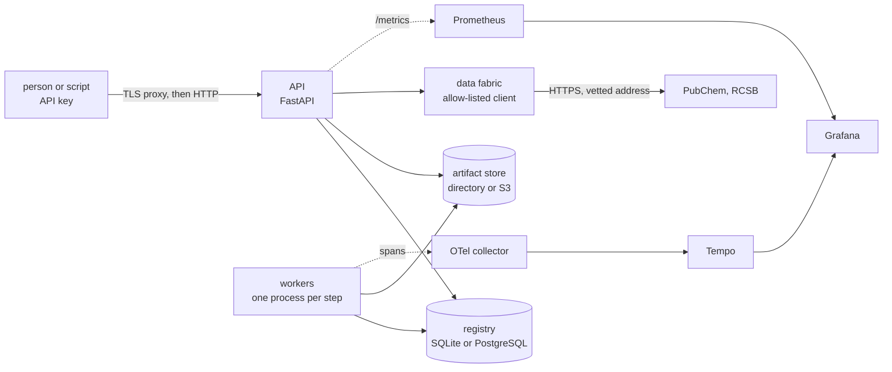

# The control plane

[← back to the README](../README.md)

`substrate.control` runs the scientific core as a service: many people, many runs, one database, workers that may be on other machines. The core (`Pipeline`, the engines,
the translators) is unchanged and still works without any of this; the control plane is the `platform` extra (`pip install -e ".[platform]"`) and adds nothing to a plain install.

Read [SECURITY.md](../SECURITY.md) for what it defends and what it does not, and the last section here for what has not been run against the real thing.



## A first run

```bash
pip install -e ".[platform]"
python -m substrate platform init --tenant lab                  # creates the database, a tenant and its administrator; prints the key once
export SUBSTRATE_API_KEY=sbs_...                                 # the key; from the environment, never the command line
python -m substrate platform submit experiments/proton_transfer.yaml --wait
python -m substrate platform reproduce RUN-000001 --wait         # run it again and compare
python -m substrate platform serve                               # the API on 127.0.0.1:8080
python -m substrate platform worker --queues cpu,chemistry,quantum --isolation process
```

`--db` / `SUBSTRATE_DB` is a SQLAlchemy URL (SQLite by default; PostgreSQL for a deployment, from `SUBSTRATE_DB_FILE` when the URL must not be in the environment), `--store` /
`SUBSTRATE_STORE` is a directory or `s3://bucket/prefix`. `submit --wait` exits 0 if the run's worst axis is PASS or WARN and 2 otherwise.

## What is in it

| Module | What it does |
|---|---|
| `registry.py`, `db.py` | The tenant-scoped database (SQLAlchemy Core): tenants, principals, API keys (only the SHA-256 of the secret is stored), experiments, runs, tasks, artifacts, datasets, usage, and a hash-chained event log. Every query for user data filters by the principal's tenant; a lookup of another tenant's object answers "not found", not "forbidden". |
| `security.py` | Roles (ADMIN, RESEARCHER, OPERATOR, VIEWER, SERVICE), what each may do, API-key format and checks, and the default quotas (runs, tasks, compute-seconds and QPU jobs per day; concurrent runs, stored bytes, experiments per tenant). |
| `taskqueue.py` | The queue as a state machine in the database: a claim is one conditional UPDATE, so two workers cannot take the same task on SQLite or PostgreSQL; leases that a dead worker stops renewing; exponential backoff; a failed task's dependents are skipped at once. |
| `tasks.py`, `steps.py`, `worker.py` | A run becomes tasks (below); a worker claims, executes (in the worker or in its own process), stores the output as an artifact, and completes or fails the task. Failures are classified (below). |
| `orchestrator.py` | Submit, reproduce, cancel; charges the quota and refuses before anything is spent; closes a run exactly once when its last task ends and writes its six-axis status. |
| `status.py` | The six-axis run status and the rule that decides which axis a failure belongs to. |
| `artifacts.py` | Content-addressed storage (the SHA-256 of the bytes is the name, per tenant), a narrow set of media types, the checksum verified on every read, a local directory store and an S3-compatible one. |
| `repro.py` | The environment fingerprint, the result digest, and the comparison a reproduction is judged by. |
| `sandbox.py` | Runs a step in its own process: deadline, scrubbed environment, no unpickling of anything the child sends back, and on Linux address-space and CPU limits. |
| `fabric/` | The data fabric: an HTTP client that can only reach named hosts, adapters that validate what they receive field by field, and versioned immutable datasets with checksum and provenance. |
| `../qpu.py`, `gateway.py` | A small quantum solver behind the engines' backend interface; the policy that bounds what a quantum job may ask for; the gateway that adds a per-user hardware quota and an audit record. |
| `observability.py` | Prometheus metrics, OpenTelemetry spans, JSON logs with credentials redacted. |
| `api.py`, `cli.py` | The HTTP interface and the `platform` command. |

## How a run flows

An experiment is validated, its pinned datasets are checked, each planned step becomes a task, an ensemble (if asked for) is one more task, then a check and a report. A
transfer study is stored as an experiment too (`{"transfer": {...}}`), so it is hashed, listed, run and reproduced like any other.

```
experiment:  validate -> ingest -> 00-solve:... -> 01-translate:... -> ... -> [uncertainty] -> check -> report
transfer:    validate_transfer -> reference:<id> (one per surface; on the chemistry queue if its engine runs a quantum-chemistry program) -> transfer -> report
```

A task goes to the `chemistry` queue if its engine runs a quantum-chemistry program, to `quantum` if the run asked for the quantum backend, and to `cpu` otherwise, so a
worker pool can be sized and placed for each. Each step's output is an artifact; the run's report names them. A run produces the same numbers through the control plane
as `Pipeline.run` does directly (tested for the nine-scale pathway), and with `--isolation process` as in-process.

### Six axes, not one word

"Failed" hides what kind of failure it was, and the kinds need different responses. A run ends with a verdict on each of six axes, each PASS, WARN, FAIL, UNKNOWN (the axis
applies but the run ended before it could be judged) or SKIPPED (it does not apply):

| Axis | The question |
|---|---|
| execution | Did the computation run to the end? |
| physics | Did the models accept their inputs, and what did they warn about? |
| validation | Was the request well formed? |
| security | Did anything breach a limit, a quota, a policy or an authorisation check? |
| reproducibility | Are the environment, seed and data versions recorded and resolved, and on a rerun, do the results match? |
| uncertainty | Was spread estimated, and did it complete? |

Which axis a failure belongs to is decided by where it happened and what kind of error it was (`status.classify_failure`), never by reading a message. A policy refusal is
security wherever it occurs; a `ValidationError` from the input checks is validation, but from a model it is physics (a model whose assumptions do not hold is a
scientific result, not a crash); a missing or altered dataset is reproducibility; a crash or a timeout is execution. The deterministic refusals (validation, resource limits,
quotas, authorisation, quantum policy, an unavailable dataset) are never retried, because the same input would be refused again.

### Reproduction

`platform reproduce RUN` starts a new run of the same experiment with the same seed and ensemble size, and when it ends compares the two. Each run records an
**environment fingerprint** (Python, platform, the versions of the packages that matter, the image digest if the deployment supplies one), hashed over the software identity
and not over the hardware (a different CPU is recorded but is not a different environment), and a **result digest** over the rounded final observables (a quick look, not a verdict: two honest runs of the same experiment on the same machine can have different digests, for the
reason given below, and this was found the hard way, when a test that asserted equal digests failed about one run in thirty).

The comparison is relative only, because the observables span 40 orders of magnitude; array elements that are near zero are compared against a floor tied to the array's
own scale. The tolerance is 1e-6, and that number was measured, not chosen: the ODE solver is adaptive, so a one-ULP change in one input (the kind of difference a different
BLAS or operating system makes) moved an output by up to about 8e-10 relative, and the tolerance has to sit above that and well below any real difference. A 1e-3
perturbation of an input is detected and a 1e-9 one is tolerated (both tested). A reproduction that matches in a different environment is WARN, not PASS: the results agree
but it is not the same software.

## Discarded information

Every translator now declares what it throws away (`Translator.discarded`), and the pipeline copies that into each product's provenance and into the run report. The molecular
to quantum hop, for example, discards the heavy-atom motion (the O···O distance is frozen); the quantum to reaction hop discards the tunnelling coherence and keeps only a rate.
The electronic-to-quantum hop, for example, discards the donor–acceptor distance as a variable (the heavy atoms are held at the scan's distance), and the quantum-to-reaction hop
replaces the tunnel splitting with incoherent hopping between localised levels. A reader of a result can see, at each hop, which information did not survive it. This is documentation
that travels with the data; it is not a measure of how much was lost.

## The data fabric

Three adapters ship: `pubchem.compound` (PUG REST), `rcsb.entry` (the PDB data API) and `nist.ion_energetics` (the bundled NIST set, no network). An ingest is an authenticated,
quota-counted, audited call that produces a **dataset version**: the normalised records, their checksum, the bytes as received (kept as an artifact), the source, the licence
text and the time. A version never changes; a new fetch is a new version, and an experiment pins the versions it uses, so it can be reproduced after the source has moved on.

The client is the only code in the package that opens a connection, and it is strict: hosts on an allowlist only; HTTPS (plain HTTP to loopback only, and only when a test or
a local mirror enables it); no credentials, fragment or unusual port in the URL; the host is resolved **once**, any private, loopback, link-local (this covers 169.254.169.254, the
cloud metadata service), multicast, reserved, unspecified or shared-address-space address is refused, and the connection goes to the vetted address itself, so a DNS answer that
changes between the check and the connection cannot redirect it; redirects are followed only within the allowlist, re-checked at every hop, at most three; only status 200 and a
listed content type are accepted; the size is capped before and while reading; and no error message contains a query string. Adapters then validate every field of every
record (type, range, pattern, length) before anything is stored.

## Quantum solvers and the gateway

`QuantumSolverBackend` plugs into the same `SolverBackend` seam as the classical one and diagonalises the electronic engines' two-level Hamiltonians by a variational
calculation on one qubit (an RY ansatz, a coarse scan for the basin, Newton steps with parameter-shift derivatives, every energy an expectation value from the simulated
circuit). It matches `numpy.linalg.eigh` to about 1e-15 and refuses anything that is not a real symmetric 2×2 matrix instead of quietly using the classical routine, so a run that
says "quantum" is one. **That is a simulator on a 2×2 problem. It shows the seam and the policy, not a quantum advantage, and no hardware provider is included.**

`QuantumPolicy` bounds what a job may ask for (providers, qubits, depth, gates, shots, circuits) and refuses before anything runs. `QPUGateway` is where a hardware provider
would be added: the policy, a per-user daily quota that defaults to zero until an administrator grants some, and an audit record of every authorised and refused job.

## Seeing it

`/metrics` (OPERATOR or ADMIN only) exposes counters for runs submitted, requests refused and failed logins, and gauges read from the database at scrape time: queue depth by
queue, active runs by state, and what the workers did in the last 24 hours (tasks by state and kind, failures by status axis, task times, runs and axis outcomes). The gauges come
from the database because a worker is another process, and its own counters never reach the process that serves `/metrics`. Labels are only things with a handful of values;
none names a run, a task or a person. `deploy/grafana/dashboards/substrate.json` draws them and `deploy/prometheus/alerts.yml` alerts on them; a test checks that every series,
label and label value those two files name is one the code emits.

Workers log one JSON object per line (credentials redacted before the line is written) and, if `OTEL_EXPORTER_OTLP_ENDPOINT` is set and the `otlp` extra is installed, send a span
per task attempt. The trace id is derived from the run id, so the tasks of one run, executed by different workers in different processes, are one trace without any context being
passed between them.

## Running it for more than one person

`deploy/` holds a Dockerfile (a pinned base, a two-stage build from the pinned wheels, uid 10001), a Compose file (PostgreSQL, the API, two workers, a collector, Tempo, Prometheus,
Grafana; ports on loopback only; internal networks; read-only roots; no capabilities; secrets as files), Kubernetes manifests (the restricted Pod Security Standard, default-deny
network policies, secrets mounted file by file) and a README for the secrets. `docker compose config` and `kubectl kustomize` accept the files, and `tests/test_deploy.py` checks the
security properties they claim and that every command, file, port and metric they refer to exists. See the section below for what that does and does not prove.

## The API

| | |
|---|---|
| `GET /healthz`, `/readyz`, `/metrics` | liveness; readiness (the database answers); metrics (OPERATOR, ADMIN) |
| `GET /models` | the registered engines and translators, with their approximations |
| `POST /experiments`, `GET /experiments[/id]` | store (validated before it is stored), list, read |
| `POST /runs`, `GET /runs[/id]`, `POST /runs/id/cancel` | start, list, read (state, six-axis status, progress), cancel |
| `GET /runs/id/artifacts`, `/runs/id/lineage`, `GET /artifacts/sha256` | the run's outputs; its hash-chained event log; one artifact (checksum verified) |
| `POST /reproduce/id`, `GET /reproduce/id` | start a reproduction; the comparison |
| `POST /transfers`, `GET /transfers/id` | a transfer study over stored reference experiments |
| `GET /datasets[/adapters]`, `POST /datasets/ingest`, `GET /datasets/id[/version]` | the data fabric |
| `GET /audit` | the tenant's audit trail (OPERATOR, ADMIN) |

Bearer-token authentication on everything but the two health checks; bodies over 1 MB are refused with 413; responses carry `nosniff`, `no-store`, a content-security policy that
allows nothing and `X-Frame-Options: DENY`; quota refusals are 429, limit refusals 413, authorisation 403, a failed fetch from a data source 502, and another tenant's object is 404.

## What has and has not been verified

Tested, each by tests that were shown to fail when the behaviour was broken (612 one-line mutants of the control plane's modules were applied one at a time, and 586 are caught; the 26 that are not are
accounted for in [validation.md](validation.md)): tenant isolation; the role table; key handling; the queue's
state machine, including concurrent workers racing for one task (repeated runs); the six-axis classification; reproduction (a 1e-3 change detected, 1e-9 tolerated); artifact
integrity and the media-type allowlist; process isolation (a deadline kill, a scrubbed environment, a crash in the child); the fabric client against local servers, including
redirects, oversize bodies and a hostile DNS answer; the adapters against fixtures; the quantum backend against `eigh`; the metrics, the dashboards and alerts against the metrics
the code emits; the deployment files' structure and security properties.

Not verified, and not claimed:

- **No container has been built or started, and no Kubernetes cluster was used.** The Dockerfile, Compose file and manifests are accepted by the parsers and checked for the properties
  above, but whether PostgreSQL starts read-only as a non-root user, whether the shared artifact volume has the right ownership, or whether Grafana loads the provisioned
  dashboard has not been seen. CI builds the image and starts it under the same restrictions on its first run.
- **PostgreSQL has not been run.** Everything was exercised on SQLite. The code uses SQLAlchemy Core and conditional updates that PostgreSQL also supports, and the schema creation takes an
  advisory lock there (tested with a stand-in), but a real server may expose something SQLite did not.
- **The PubChem and RCSB adapters have never talked to the real services.** They were written from the services' documentation and tested against local servers that return what the
  documentation says. A live fetch is the test that matters and has not been done.
- **The S3 artifact store is tested against a fake client only**, and the image does not include boto3.
- **The resource limits on a step (address space, CPU time, file size) exist only on Linux** (`resource`); their tests are skipped on Windows and run in CI, which has not run yet. The same code was run by hand on
  Ubuntu 22.04 under WSL: a 1 GiB allocation under a 400 MiB limit raised `MemoryError`, an 11 MiB write under the 10 MiB file limit failed with `EFBIG`, and a requested limit was clamped to the hard limit the process already had.
- **A process per step is not a security boundary against hostile code.** The experiments are data and the engines are a fixed registry, so the step runs code this package ships;
  the process isolation is for crashes, deadlines and leaked environment, and the container is the boundary for the rest.
- **No hardware quantum provider exists** (see above), and the quantum solver is a simulator.
- **There is no Redis or other broker.** The queue is the database. It is simple and correct under the tests, and it will not scale to thousands of tasks per second.
- **No TLS, no rate limiting by address, no single sign-on.** The API speaks plain HTTP and expects a TLS-terminating proxy; quotas are per principal per day.
