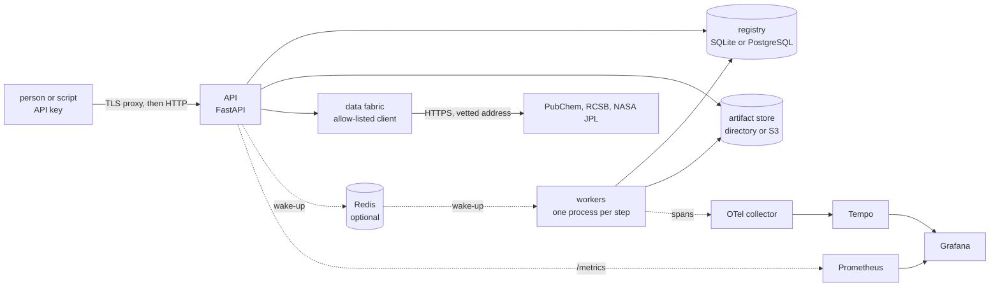

# The control plane

[← back to the README](../README.md)

`substrate.control` runs the scientific core as a service: many people, many runs, one database, workers that may be on other machines. The core (`Pipeline`, the engines,
the translators) is unchanged and still works without any of this; the control plane is the `platform` extra (`pip install -e ".[platform]"`) and adds nothing to a plain install.

Read [SECURITY.md](../SECURITY.md) for what it defends and what it does not, and the last section here for what has not been run against the real thing.



## A first run

```bash
pip install -e ".[platform]"
python -m substrate platform init --tenant lab                  # creates the database, a tenant and its administrator; prints the key once
export SUBSTRATE_API_KEY=sbs_...                                 # the key; from the environment, never the command line
python -m substrate platform submit experiments/proton_transfer.yaml --wait
python -m substrate platform reproduce RUN-000001 --wait         # run it again and compare
python -m substrate platform serve                               # the API on 127.0.0.1:8080
python -m substrate platform worker --queues cpu,chemistry,quantum --isolation process
```

`platform check` exits 0 when the database answers and has its tables (and a local artifact directory is writable) and prints only the type of a failure: it is the workers' health check. `serve` and
`worker` wait up to `SUBSTRATE_DB_WAIT_S` seconds (60 by default) for the database to come up. `SUBSTRATE_REDIS_URL` or `SUBSTRATE_REDIS_URL_FILE` turns on the Redis wake-up (extra `redis`);
`SUBSTRATE_QPU_PROVIDERS` and `SUBSTRATE_QPU_HARDWARE` say which quantum providers a run may name and which of them are devices (default: the simulator only).

`--db` / `SUBSTRATE_DB` is a SQLAlchemy URL (SQLite by default; PostgreSQL for a deployment, from `SUBSTRATE_DB_FILE` when the URL must not be in the environment), `--store` /
`SUBSTRATE_STORE` is a directory or `s3://bucket/prefix`. `submit --wait` exits 0 if the run's worst axis is PASS or WARN and 2 otherwise.

## What is in it

| Module | What it does |
|---|---|
| `registry.py`, `db.py` | The tenant-scoped database (SQLAlchemy Core): tenants, principals, API keys (only the SHA-256 of the secret is stored), experiments, runs, tasks, artifacts, datasets, usage, and a hash-chained event log. Every query for user data filters by the principal's tenant; a lookup of another tenant's object answers "not found", not "forbidden". |
| `security.py` | Roles (ADMIN, RESEARCHER, OPERATOR, VIEWER, SERVICE), what each may do, API-key format and checks, and the default quotas (runs, tasks, compute-seconds and QPU jobs per day; concurrent runs, stored bytes, experiments per tenant). |
| `taskqueue.py` | The queue as a state machine in the database: a claim is one conditional UPDATE, so two workers cannot take the same task on SQLite or PostgreSQL; leases that a dead worker stops renewing; exponential backoff; a failed task's dependents are skipped at once. |
| `tasks.py`, `steps.py`, `worker.py` | A run becomes tasks (below); a worker claims, executes (in the worker or in its own process), stores the output as an artifact, and completes or fails the task. Failures are classified (below). |
| `orchestrator.py` | Submit, reproduce, cancel; charges the quota and refuses before anything is spent; closes a run exactly once when its last task ends and writes its six-axis status. |
| `status.py` | The six-axis run status and the rule that decides which axis a failure belongs to. |
| `artifacts.py` | Content-addressed storage (the SHA-256 of the bytes is the name, per tenant), a narrow set of media types, the checksum verified on every read, a local directory store and an S3-compatible one. |
| `repro.py` | The environment fingerprint, the result digest, and the comparison a reproduction is judged by. |
| `sandbox.py` | Runs a step in its own process: deadline, scrubbed environment, no unpickling of anything the child sends back, and on Linux address-space and CPU limits. |
| `notify.py` | An optional wake-up for idle workers over Redis: a notification carries no data, all Redis I/O is on background threads, and without Redis the workers poll the database as before. |
| `../qpu_qiskit.py` | Qiskit as a quantum provider (extra `qiskit`): Aer, emulated IBM devices, and IBM's devices for a deployment that supplies a token; a one-qubit solver that fits measured energies. |
| `fabric/` | The data fabric: an HTTP client that can only reach named hosts, adapters that validate what they receive field by field, and versioned immutable datasets with checksum and provenance. |
| `../qpu.py`, `gateway.py` | A small quantum solver behind the engines' backend interface; the policy that bounds what a quantum job may ask for; the gateway that adds a per-user hardware quota and an audit record. |
| `observability.py` | Prometheus metrics, OpenTelemetry spans, JSON logs with credentials redacted. |
| `api.py`, `cli.py` | The HTTP interface and the `platform` command. |

## How a run flows

An experiment is validated, its pinned datasets are checked, each planned step becomes a task, an ensemble (if asked for) is one more task, then a check and a report. A
transfer study is stored as an experiment too (`{"transfer": {...}}`), so it is hashed, listed, run and reproduced like any other.

```
experiment:  validate -> ingest -> 00-solve:... -> 01-translate:... -> ... -> [uncertainty] -> check -> report
transfer:    validate_transfer -> reference:<id> (one per surface; on the chemistry queue if its engine runs a quantum-chemistry program) -> transfer -> report
```

A task goes to the `chemistry` queue if its engine runs a quantum-chemistry program, to `quantum` if the run asked for the quantum backend, and to `cpu` otherwise, so a
worker pool can be sized and placed for each. Each step's output is an artifact; the run's report names them. A run produces the same numbers through the control plane
as `Pipeline.run` does directly (tested for the nine-scale pathway), and with `--isolation process` as in-process.

### Six axes, not one word

"Failed" hides what kind of failure it was, and the kinds need different responses. A run ends with a verdict on each of six axes, each PASS, WARN, FAIL, UNKNOWN (the axis
applies but the run ended before it could be judged) or SKIPPED (it does not apply):

| Axis | The question |
|---|---|
| execution | Did the computation run to the end? |
| physics | Did the models accept their inputs, and what did they warn about? |
| validation | Was the request well formed? |
| security | Did anything breach a limit, a quota, a policy or an authorisation check? |
| reproducibility | Are the environment, seed and data versions recorded and resolved, and on a rerun, do the results match? |
| uncertainty | Was spread estimated, and did it complete? |

Which axis a failure belongs to is decided by where it happened and what kind of error it was (`status.classify_failure`), never by reading a message. A policy refusal is
security wherever it occurs; a `ValidationError` from the input checks is validation, but from a model it is physics (a model whose assumptions do not hold is a
scientific result, not a crash); a missing or altered dataset is reproducibility; a crash or a timeout is execution. The deterministic refusals (validation, resource limits,
quotas, authorisation, quantum policy, an unavailable dataset) are never retried, because the same input would be refused again.

### Reproduction

`platform reproduce RUN` starts a new run of the same experiment with the same seed and ensemble size, and when it ends compares the two. Each run records an
**environment fingerprint** (Python, platform, the versions of the packages that matter, the image digest if the deployment supplies one), hashed over the software identity
and not over the hardware (a different CPU is recorded but is not a different environment), and a **result digest** over the rounded final observables (a quick look, not a verdict: two honest runs of the same experiment on the same machine can have different digests, for the
reason given below, and this was found the hard way, when a test that asserted equal digests failed about one run in thirty).

The comparison is relative only, because the observables span 40 orders of magnitude; array elements that are near zero are compared against a floor tied to the array's
own scale. The tolerance is 1e-6, and that number was measured, not chosen: the ODE solver is adaptive, so a one-ULP change in one input (the kind of difference a different
BLAS or operating system makes) moved an output by up to about 8e-10 relative, and the tolerance has to sit above that and well below any real difference. A 1e-3
perturbation of an input is detected and a 1e-9 one is tolerated (both tested). A reproduction that matches in a different environment is WARN, not PASS: the results agree
but it is not the same software.

## Discarded information

Every translator now declares what it throws away (`Translator.discarded`), and the pipeline copies that into each product's provenance and into the run report. The molecular
to quantum hop, for example, discards the heavy-atom motion (the O···O distance is frozen); the quantum to reaction hop discards the tunnelling coherence and keeps only a rate.
The electronic-to-quantum hop, for example, discards the donor–acceptor distance as a variable (the heavy atoms are held at the scan's distance), and the quantum-to-reaction hop
replaces the tunnel splitting with incoherent hopping between localised levels. A reader of a result can see, at each hop, which information did not survive it. This is documentation
that travels with the data; it is not a measure of how much was lost.

## The data fabric

Four adapters ship: `pubchem.compound` (PUG REST), `rcsb.entry` (the PDB data API), `jpl.spectral_lines` (NASA JPL's submillimeter, millimeter and microwave line catalog) and `nist.ion_energetics`
(the bundled NIST set, no network). An ingest is an authenticated,
quota-counted, audited call that produces a **dataset version**: the normalised records, their checksum, the bytes as received (kept as an artifact), the source, the licence
text and the time. A version never changes; a new fetch is a new version, and an experiment pins the versions it uses, so it can be reproduced after the source has moved on.

`jpl.spectral_lines` takes a species tag (`{"tag": 18003}` is water) and reads the catalog's fixed-width line file as its own documentation describes it: frequency and its error in MHz,
the log10 of the integrated intensity at 300 K in nm²·MHz, the rotational degrees of freedom, the lower-state energy in cm⁻¹, the upper-state degeneracy, the species tag (a negative tag in the
file means the line was measured in the laboratory; the record keeps the tag positive and a `measured` flag), and the quantum numbers as the catalog's own text, because their coding depends on the
format code. A line that does not have the layout is an error naming its number, and so is a file of another species. The client refuses anything over 5 MB, which is about 62,000 lines, so the
largest species cannot be fetched. A source can change its format without notice; the field checks are what would notice, and the opt-in live tests say whether it has.

The client is the only code in the package that opens a connection, and it is strict: hosts on an allowlist only; HTTPS (plain HTTP to loopback only, and only when a test or
a local mirror enables it); no credentials, fragment or unusual port in the URL; the host is resolved **once**, any private, loopback, link-local (this covers 169.254.169.254, the
cloud metadata service), multicast, reserved, unspecified or shared-address-space address is refused, and the connection goes to the vetted address itself, so a DNS answer that
changes between the check and the connection cannot redirect it; redirects are followed only within the allowlist, re-checked at every hop, at most three; only status 200 and a
listed content type are accepted (an adapter may name the type to assume when a server sends none, as JPL's does; a type that is sent and not accepted is still refused); the size is capped before and while reading; and no error message contains a query string. Adapters then validate every field of every
record (type, range, pattern, length) before anything is stored.

## Quantum solvers and the gateway

`QuantumSolverBackend` plugs into the same `SolverBackend` seam as the classical one and diagonalises the electronic engines' two-level Hamiltonians by a variational
calculation on one qubit (an RY ansatz, a coarse scan for the basin, Newton steps with parameter-shift derivatives, every energy an expectation value from the simulated
circuit). It matches `numpy.linalg.eigh` to about 1e-15 and refuses anything that is not a real symmetric 2×2 matrix instead of quietly using the classical routine, so a run that
says "quantum" is one. **That is a simulator on a 2×2 problem. It shows the seam and the policy, not a quantum advantage.**

`QuantumPolicy` bounds what a job may ask for (providers, qubits, depth, gates, shots, circuits) and refuses before anything runs; a deployment names the providers it allows in
`SUBSTRATE_QPU_PROVIDERS`, and the ones among them that are physical devices in `SUBSTRATE_QPU_HARDWARE`. `QPUGateway` adds, for a device, a per-user daily quota that defaults to zero until an
administrator grants some, and writes an audit record of every authorised and refused job.

**The Qiskit providers** (`pip install -e ".[qiskit]"`, module `substrate.qpu_qiskit`) are named in an experiment's `backend:` block: `qiskit-aer` (Aer's ideal simulator, sampling shots),
`qiskit-fake` with `device: sherbrooke` (Aer with the noise model, coupling map and basis gates of a real IBM device; nothing leaves the machine) and `ibm` with `device: <backend name>` (IBM's
devices through `qiskit-ibm-runtime`, with a token from `QISKIT_IBM_TOKEN` or `QISKIT_IBM_TOKEN_FILE`). `shots` and `seed` are optional keys of the block and are part of the experiment's hash. The solver
measures ⟨Z⟩ and ⟨X⟩ of an RY state at eight angles, which gives the energy of a 2×2 Hamiltonian as a sinusoid, and fits it: sampling noise appears as scatter, and device noise damps the fit's
amplitudes, so **the ground energy of a noisy provider is biased high** (the numbers are below). Without a `seed` a run does not reproduce to the digit; with one, an emulated run does (for the same Qiskit
and Aer), and a run on a device cannot be seeded. A step in a sandbox has a scrubbed environment, so it has no token: hardware needs `--isolation inline`, and a missing token fails the step as a deployment
problem (the execution axis), once, without a retry.

## Seeing it

`/metrics` (OPERATOR or ADMIN only) exposes counters for runs submitted, requests refused and failed logins, and gauges read from the database at scrape time: queue depth by
queue, active runs by state, and what the workers did in the last 24 hours (tasks by state and kind, failures by status axis, task times, runs and axis outcomes). The gauges come
from the database because a worker is another process, and its own counters never reach the process that serves `/metrics`. Labels are only things with a handful of values;
none names a run, a task or a person. `deploy/grafana/dashboards/substrate.json` draws them and `deploy/prometheus/alerts.yml` alerts on them; a test checks that every series,
label and label value those two files name is one the code emits.

Workers log one JSON object per line (credentials redacted before the line is written) and, if `OTEL_EXPORTER_OTLP_ENDPOINT` is set and the `otlp` extra is installed, send a span
per task attempt. The trace id is derived from the run id, so the tasks of one run, executed by different workers in different processes, are one trace without any context being
passed between them.

## Running it for more than one person

`deploy/` holds a Dockerfile (a pinned base, a two-stage build from the pinned wheels, uid 10001), a Compose file (PostgreSQL, Redis, the API, two workers, a collector, Tempo, Prometheus,
Grafana; ports on loopback only, movable with `SUBSTRATE_API_PORT` and `SUBSTRATE_GRAFANA_PORT`; internal networks; read-only roots; no capabilities; secrets as files), Kubernetes manifests (the
restricted Pod Security Standard, default-deny network policies, secrets mounted file by file), a Helm chart (`deploy/helm/substrate`, the same workloads and policies, with switches for the bundled
PostgreSQL, the image digest, the replicas and the network policies, and an artifact claim that `helm uninstall` keeps), `verify_networks.py` (see below) and a README for the secrets.
`tests/test_deploy.py` checks the security properties they claim, on the manifests and on what the chart renders, and that every command, file, port and metric they refer to exists. The section
below says what was also run, and what was not. The image does not contain the `qiskit` extra (it is large); build a derived image if a deployment needs it.

## The API

| | |
|---|---|
| `GET /healthz`, `/readyz`, `/metrics` | liveness; readiness (the database answers); metrics (OPERATOR, ADMIN) |
| `GET /models` | the registered engines and translators, with their approximations |
| `POST /experiments`, `GET /experiments[/id]` | store (validated before it is stored), list, read |
| `POST /runs`, `GET /runs[/id]`, `POST /runs/id/cancel` | start, list, read (state, six-axis status, progress), cancel |
| `GET /runs/id/artifacts`, `/runs/id/lineage`, `GET /artifacts/sha256` | the run's outputs; its hash-chained event log; one artifact (checksum verified) |
| `POST /reproduce/id`, `GET /reproduce/id` | start a reproduction; the comparison |
| `POST /transfers`, `GET /transfers/id` | a transfer study over stored reference experiments |
| `GET /datasets[/adapters]`, `POST /datasets/ingest`, `GET /datasets/id[/version]` | the data fabric |
| `GET /audit` | the tenant's audit trail (OPERATOR, ADMIN) |

Bearer-token authentication on everything but the two health checks; bodies over 1 MB are refused with 413; responses carry `nosniff`, `no-store`, a content-security policy that
allows nothing and `X-Frame-Options: DENY`; quota refusals are 429, limit refusals 413, authorisation 403, a failed fetch from a data source 502, and another tenant's object is 404.

## What has and has not been verified

Tested, each by tests that were shown to fail when the behaviour was broken (612 one-line mutants of the control plane's modules were applied one at a time, and 586 are caught; the 26 that are not are
accounted for in [validation.md](validation.md); the Redis notifier, the JPL adapter and the Qiskit providers were written after that pass and have not been mutation-tested): tenant isolation; the role table;
key handling; the queue's state machine, including concurrent workers racing for one task (repeated runs); the six-axis classification; reproduction (a 1e-3 change detected, 1e-9 tolerated); artifact
integrity and the media-type allowlist; process isolation (a deadline kill, a scrubbed environment, a crash in the child); the fabric client against local servers, including redirects, oversize bodies and
a hostile DNS answer; the adapters against fixtures; the quantum backends against `eigh`; the metrics, the dashboards and alerts against the metrics the code emits; the deployment files' structure and
security properties. CI (GitHub Actions, Linux) runs the suite on Python 3.10, 3.11 and 3.12 from the locked dependencies, the core alone, the Qiskit providers, a container build and start, a
vulnerability audit of every lock file, and CodeQL; the Linux-only resource limits are among the tests it runs.

**Run against real systems on 12 October 2026**, on one Windows 11 machine (Docker Desktop, Docker Engine 25.0.3, Compose 2.24.6; minikube 1.33.1 with Kubernetes 1.30 and Calico), with what each run found:

- **The container stack.** The image builds from the locked wheels, and the whole Compose stack (PostgreSQL 16, Redis 7.4, the API, two workers, the OpenTelemetry collector, Tempo, Prometheus, Grafana)
  starts under its restrictions: read-only roots, no capabilities, non-root users. A run submitted through the API succeeded on the workers; its artifacts were stored and read back, its lineage and the
  audit chain verified, and its reproduction passed (largest relative difference 0). The seven task spans of the run arrived in Tempo as one trace, found by the id computed from the run id (Tempo labels the
  trace "root span not yet received", because the root is a synthetic parent that is never exported, by design). Prometheus scraped the API with an OPERATOR key and loaded the six alert rules; Grafana
  reached both data sources and loaded the provisioned dashboard. The 14 queries behind the dashboard's panels all ran through Grafana to Prometheus without an error; 11 returned data after a few runs and some failed logins, and the three that were still empty (queue depth by queue, failed tasks by axis, requests refused) are for events that had not happened (causing failed logins made that panel fill). I did not look at the rendered dashboard.
  *Found and fixed:* workers inherited an HTTP health check they can never pass (now `platform check`); they ignored SIGTERM as PID 1, so `docker stop` waited out its timeout (now 2.7 s, and a worker
  finishes its task first); and with Redis stopped every submit blocked 4 to 8 s in a DNS lookup that no socket timeout covers (all Redis I/O is on background threads now; submit takes about 0.1 s).
- **A Docker bug that is not in this repository.** Docker Engine 25.0 with Compose 2.24 sometimes creates a container attached to only some of its networks, silently. A two-service alpine project with two
  networks shows it about 2 times in 10 (plain `docker run` plus `docker network connect` did not, in 10), so it is not this Compose file. `deploy/verify_networks.py` compares every container's networks with
  the file's and names the ones that are wrong; `docker compose up -d --force-recreate <service>` usually fixes it. I first blamed the order of the networks listed, and said so in an earlier commit
  message and a test; that was wrong (three good runs were luck) and the test is gone.
- **PostgreSQL.** The control-plane tests ran against a real PostgreSQL 16 (`SUBSTRATE_TEST_PG_URL`: every SQLite registry a test builds gets a private schema there): 1,063 passed, after two tests that read
  SQLite's file were made database-agnostic. The CLI tests that start a subprocess still use SQLite. The platform also ran on PostgreSQL in the containers and in the cluster.
- **S3.** The artifact store ran against a real S3-compatible server, SeaweedFS 4.47 (MinIO no longer publishes images): 8 tests, covering a round trip, tenant isolation, a tampered object, 5 MB of binary,
  wrong credentials, an unreachable server, the CLI's `s3://` location, and a whole run with its reproduction. It found that every `ClientError` was read as "no such object", so a 403 from wrong credentials
  was a missing artifact (a 404 from the API); only a real 404 is "missing" now. **AWS S3 itself was not run.**
- **Redis.** The wake-up was tested against a real password-protected Redis 7.4 (a notification wakes a waiter, a burst is one wake-up, a wrong password degrades to polling, and a run is picked up by a
  worker that was asleep on a 60 s poll) and in the Compose stack, where an idle worker starts 0.1 to 0.5 s after a submit.
- **PubChem, RCSB and NASA JPL.** `tests/test_control_fabric_live.py` (off unless `SUBSTRATE_TEST_LIVE=1`) fetched all three through the real client over HTTPS and passed 5 of 5: aspirin and water from
  PubChem, 4HHB from RCSB, and the water and CO line lists from JPL, whose 22.235 GHz and 183.310 GHz lines come out with their textbook quantum numbers. Five JPL files (6,700 lines) parse and validate.
  The first JPL pattern refused Fortran's `.0005`; a real file showed it. JPL's server sends no `Content-Type`, which the client refused until an adapter could name the type to assume.
- **Kubernetes.** On minikube with Calico, both the kustomize manifests and the Helm chart ran with every pod under the restricted Pod Security Standard (including PostgreSQL as uid 70, read-only), a run
  was submitted and reproduced through a port-forward, and 13 network-policy checks behaved as designed: workers reach PostgreSQL and nothing else; the API reaches PostgreSQL and public HTTPS (a dataset
  host) but not a worker, the Kubernetes API, the metadata address or a non-443 port; another namespace reaches neither; the `monitoring` namespace reaches the API and not the database. `helm uninstall`
  keeps the artifact and database claims, and a reinstall under the same release name found its runs and artifacts. *Found and fixed:* this README told users to reuse Compose's database URL, whose host
  is `db` (the Service is `postgres`), so the first start failed; and the pods restarted two or three times while PostgreSQL started, because they exited when the database was not up (`serve` and `worker`
  now wait for it, `SUBSTRATE_DB_WAIT_S`, 60 s by default); and the chart's artifact claim was deleted by `helm uninstall`.
- **Quantum.** The Qiskit providers ran on Aer and on Qiskit's noisy emulations of IBM Sherbrooke and Brisbane (`qiskit-ibm-runtime`'s fake devices), through the solver, through whole experiments, and in a
  sandboxed worker process. The ideal sampler recovers the eigenvalues to shot noise (0.006 at 4,000 shots); the emulated devices give a ground energy that is **too high**, by 0.013 on Sherbrooke and
  0.033 on Brisbane (which did not shrink with five times the shots), because noise damps the amplitudes the fit uses. An electronic-structure experiment on sampled energies differed from the classical one
  by 18 to 20% in its final observables: shot noise of a few meV, exponentiated by the tunnelling rates. Two runs with the same `seed` in the backend block are identical (relative difference 0.0); two
  different seeds are not. An experiment's `shots` and `seed` were silently dropped by the experiment parser until a seeded run failed to reproduce; they are kept now, and parsing no longer builds the
  emulator (a run on an emulated device took 82 s before that; a seeded Aer run takes 2 to 5 s now, and the emulated-device run was not timed again).

**Image upgrades Dependabot proposed, tried in a scratch copy of the Compose file on 12 October 2026 (none applied):** `otel/opentelemetry-collector-contrib` 0.162.0 and `prom/prometheus` v3.15.0 work with the
current configuration (runs succeed and reproduce, all seven spans of a run arrive through the new collector, Prometheus scrapes the API and loads the six alert rules; the collector warns that the `otlphttp` name
is deprecated in favour of `otlp_http`). The others do not work as the files stand: `grafana/tempo` 3.1.0 rejects `tempo.yaml` (`field compactor not found`); `grafana/grafana` 13.2.3 cannot register its built-in
Prometheus data source under the read-only root filesystem (its plugin installer fails with "read-only file system"); `postgres` 18 refuses the mount at `/var/lib/postgresql/data` (its images keep a
version-specific directory under `/var/lib/postgresql`, and a version 16 volume cannot be opened by it without a dump and restore); and `python` 3.14 cannot build the image, because the locked scientific
wheels have none for it. The numpy, scipy and pyyaml bumps change the locked runtime: numpy 2.2.6 passed the whole suite in an earlier local run, but they were not run through the studies, so they are a
decision for whoever owns the numbers.

Not verified, and not claimed:

- **No real quantum device was run.** The `ibm` provider needs a token that only a deployment supplies, and none was available. It was written from the runtime's documented interface and tested against stand-ins
  for the service and the sampler, which shows that this package's side of the conversation is right and says nothing about IBM's. The emulators are emulators.
- **Anything beyond one machine.** Nothing ran on a Linux host (Docker Desktop's Linux VM was the closest), a managed Kubernetes service, more than one node, a CNI other than Calico, a real
  ReadWriteMany storage class (minikube's provisioner was used), or behind an ingress with TLS. The Prometheus Operator's `ServiceMonitor`, and Redis in Kubernetes (neither the manifests nor the chart include one), were
  not run. ARM images were not built.
- **Load.** Nothing was measured beyond a handful of workers and a few runs. The queue is the database; it is simple and correct under the tests, and it will not serve thousands of tasks a second.
- **AWS S3, and the real IBM service** (above).
- **A process per step is not a security boundary against hostile code.** The experiments are data and the engines are a fixed registry, so the step runs code this package ships;
  the process isolation is for crashes, deadlines and leaked environment, and the container is the boundary for the rest. It is also why a hardware token never enters a step.
- **No TLS, no rate limiting by address, no single sign-on.** The API speaks plain HTTP and expects a TLS-terminating proxy; quotas are per principal per day.
